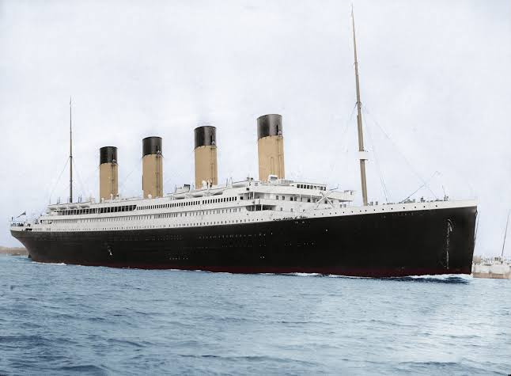
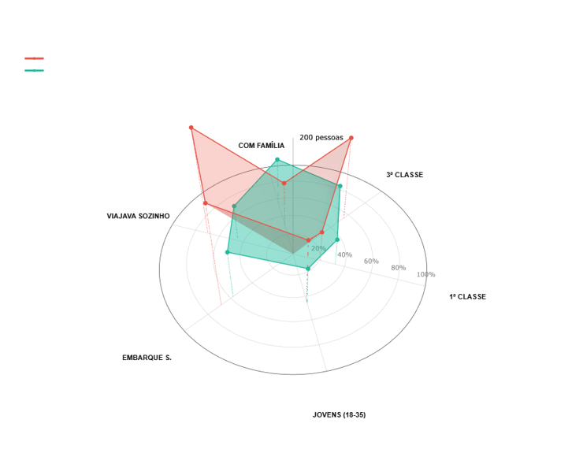
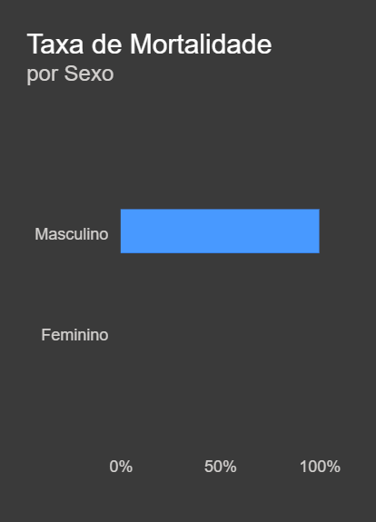
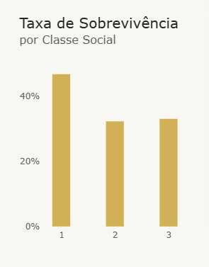
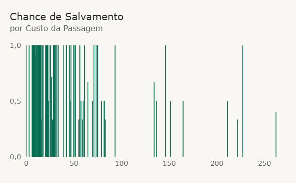
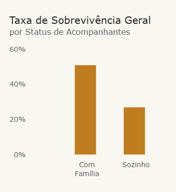
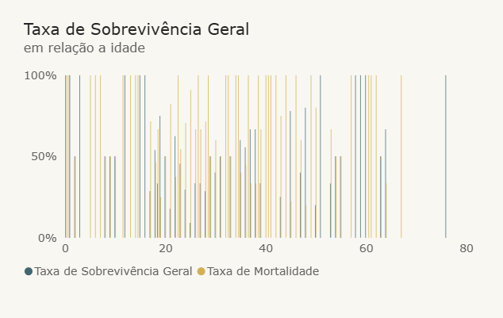

# 🚢 Análise Exploratória e Visualização de Dados — Titanic
### Desafio Técnico | Processo Seletivo — Green Team Hacker Club (UFABC)


<p align="center">
  
</p>

---

## 📌 1. Sobre o Projeto e Contexto Institucional

Este repositório reúne a solução completa do **Desafio Técnico da Área de Dados** do processo seletivo para o **Green Team Hacker Club (GTHC)** da **Universidade Federal do ABC (UFABC)**.

O **GTHC** é uma entidade estudantil voltada a segurança da informação, computação, desenvolvimento e ciência de dados, orientada pelo espírito hacker de experimentação rápida, aprendizado autodidata contínuo e resolução profunda de problemas.

### 🎯 O Desafio
O objetivo do teste foi realizar uma **Análise Exploratória de Dados (EDA)**, tratamento de inconsistências, identificação de padrões demográficos/socioeconômicos e construção de **storytelling analítico** com base em uma amostra de passageiros do RMS Titanic (418 passageiros). 

A proposta exigiu não apenas o domínio técnico de limpeza e manipulação estatística, mas também a habilidade de transformar dados brutos em tomadas de decisão visuais e relatórios executivos.

> 💡 **Destaque de Aprendizado Rápido & Autodidatismo:**  
> Sem conhecimento prévio de **Microsoft Power BI**, a ferramenta foi aprendida e dominada do zero especialmente para este desafio, resultando em um dashboard analítico completo. Além disso, foram desenvolvidas visualizações computacionais 3D interativas em Python (Plotly) com apoio de inteligência artificial generativa para prototipação e exploração volumétrica de dados.

---

## 🗂️ 2. Estrutura dos Arquivos

```bash
├── assets/                             # Imagens, gráficos e capturas do projeto
│   ├── holograma_3d_radar.png          # Visualização 3D volumétrica (Mesh3D)
│   ├── salvamento_custo_passagem_1.png # Dispersão de tarifas e salvamento
│   ├── salvamento_custo_passagem_2.png # Gráfico analítico de tarifas
│   ├── taxa_mortalidade_sexo.png       # Mortalidade segregada por gênero
│   ├── taxa_sobrevivencia_classe.png   # Sobrevivência por classe socioeconômica
│   ├── taxa_sobrevivencia_familia.png  # Impacto de viajar acompanhado vs só
│   ├── taxa_sobrevivencia_idade.png    # Distribuição por faixas etárias
│   └── titanic_capa.jpg                # Foto histórica do RMS Titanic
├── GTH.csv                             # Base tratada e traduzida (418 registros)
├── GTH.ipynb                           # Notebook com pipeline ETL e gráficos 3D Plotly
├── GTH.pbix                            # Modelo de dados e dashboard no Power BI Desktop
├── GTH PowerBI.pdf                     # Exportação do dashboard Power BI
├── Titanic.pdf                         # Apresentação executiva em 8 slides (Storytelling)
├── Informacoes.txt                     # Notas de bastidores, inferências e memórias de cálculo
├── .gitignore                          # Configuração de arquivos ignorados pelo Git
└── README.md                           # Documentação técnica do repositório
```

---

## 📊 3. Dicionário de Dados (`GTH.csv`)

O dataset trabalhado contém **418 passageiros** padronizados para o português:

| Coluna | Tipo | Descrição |
| :--- | :--- | :--- |
| `Id` | Inteiro | Identificador único do passageiro |
| `Sobreviveu` | Binário | `1` = Sobreviveu, `0` = Não sobreviveu |
| `Classe` | Ordinal | Classe socioeconômica do bilhete (`1` = 1ª, `2` = 2ª, `3` = 3ª) |
| `Nome` | Texto | Nome completo do passageiro |
| `Sexo` | Categórico | Gênero (`Masculino`, `Feminino`) |
| `Idade` | Decimal/Texto | Idade em anos (valores ausentes tratados estatisticamente) |
| `IrmaosConjuges` | Inteiro | Número de irmãos ou cônjuges a bordo |
| `PaisFilhos` | Inteiro | Número de pais ou filhos a bordo |
| `Passagem` | Texto | Código identificador do bilhete |
| `Tarifa` | Decimal/Texto | Custo pago pela passagem em Libras Esterlinas |
| `Cabine` | Texto | Número da cabine alocada |
| `Embarque` | Categórico | Porto de embarque: `S` (Southampton), `C` (Cherbourg), `Q` (Queenstown) |
| `Acompanhantes` | Inteiro | Contagem total de parentes a bordo |

---

## 🔍 4. Principais Insights e Storytelling

<p align="center">
  
  <br>
  <em>Figura 1: Holograma Comparativo 3D gerado em Python/Plotly — perfil volumétrico dos sobreviventes (verde) vs vítimas (vermelho).</em>
</p>

### 1. Relação de Gênero (Protocolo "Mulheres e Crianças Primeiro")
- **100% dos homens faleceram** (266 passageiros masculinos, correspondendo a 63,64% da amostra).
- **100% das mulheres sobreviveram** (152 passageiras femininas, correspondendo a 36,36% da amostra).
- *Contexto dos dados:* Na amostra de teste analisada, o desfecho de sobrevivência reflete a segregação estrita por gênero (modelo baseline tradicional), permitindo isolar o gênero como linha de base para dissecar como os fatores socioeconômicos, familiares e geográficos influenciaram a distribuição interna de cada grupo.

<p align="center">
  
</p>

---

### 2. Disparidade Socioeconômica (Classe e Tarifa)
- **1ª Classe:** Registrou a maior taxa de sobrevivência do navio: **46,73%** (50 de 107 passageiros).
- **2ª Classe:** **32,26%** (30 de 93 passageiros) — ligeiramente inferior à 3ª classe, sugerindo possíveis gargalos arquiteturais de evacuação nos conveses intermediários.
- **3ª Classe:** **33,03%** (72 de 218 passageiros). Mais da metade de todos os homens mortos (**54,89%**) pertencia à 3ª classe, demonstrando que a base da pirâmide suportou a maior taxa de letalidade absoluta.
- **Poder Aquisitivo:** O custo médio pago pela passagem das sobreviventes foi de **£ 49,75**, quase o dobro da média paga pelas vítimas (**£ 27,53**). Passageiros com bilhetes de alto valor ocupavam conveses superiores, mais próximos aos botes salva-vidas.

<p align="center">
  
  &nbsp;&nbsp;&nbsp;&nbsp;
  
</p>

---

### 3. Estrutura Familiar: Viajar Acompanhado Salva Vidas
- **Com Família:** Passageiros que viajavam com ao menos um familiar tiveram taxa de sobrevivência de **50,91%** (84 de 165).
- **Viajantes Solitários:** Apenas **26,98%** (68 de 253) dos passageiros que viajavam desacompanhados sobreviveram.
- Entre os homens que faleceram, **69,55%** (185 de 266) viajavam completamente sozinhos. Grupos familiares (média de ~2 parentes) apresentaram maior capacidade de auxílio mútuo e organização na evacuação rápida.

<p align="center">
  
</p>

---

### 4. Porto de Embarque e Idade
- **Porto de Embarque:**
  - **Queenstown (Irlanda):** **52,17%** de sobrevivência (24 de 46).
  - **Cherbourg (França):** **39,22%** de sobrevivência (40 de 102).
  - **Southampton (Inglaterra):** **32,59%** de sobrevivência (88 de 270).
- **Idade:**
  - A idade média geral e por gênero foi de **30,27 anos**.
  - Passageiros com idades ausentes (61 homens e 25 mulheres) tiveram seus valores imputados pela média amostral.
  - Não houve correlação isolada acentuada entre idade contínua e probabilidade de sobrevivência nesta amostra, confirmando que o gênero e o status socioeconômico foram as variáveis preponderantes.

<p align="center">
  
</p>

---

## 🛠️ 5. Tecnologias e Metodologia Empregada

### 1. Google Sheets (ETL & Validação Exploratória)
- Tratamento primário da base tabular e correção de caracteres.
- Criação de **Tabelas Dinâmicas** cruzando classes, faixas de preço e contingente familiar.
- Validação estatística das inferências manuais (documentadas em `Informacoes.txt`).

### 2. Microsoft Power BI (`GTH.pbix` / `GTH PowerBI.pdf`)
- Construção de dashboard interativo com KPIs gerenciais:
  - Cartões de resumo executivo (*Total de Passageiros: 418*, *Taxa Geral de Sobrevivência: 36,36%*).
  - Gráficos de colunas e barras segmentados por classe social, sexo e presença de acompanhantes.
  - Gráfico de dispersão com gradiente de chance de salvamento vs custo da passagem.
  - Análise contínua da taxa de sobrevivência/mortalidade por idade.

### 3. Python & Plotly (`GTH.ipynb`)
- **Pipeline Pandas & NumPy:** Limpeza de strings numéricas no padrão decimal brasileiro (vírgula por ponto), conversão de dtypes e engenharia do atributo `FamilySize = SibSp + Parch + 1`.
- **Holograma Comparativo 3D (`Mesh3d` & `Scatter3d`):** Projeção espacial em teia polar que mapeia simultaneamente proporção percentual (eixos radiais X-Y) e volume absoluto de vidas (elevação Z).
- **Micro-Análise 3D:** Gráfico de dispersão tridimensional correlacionando Idade $\times$ Tarifa $\times$ Classe Social (com inversão do eixo para a 1ª classe figurar no topo do navio) com volume da esfera ponderado pelo tamanho da família.
- **Diagrama de Sankey (Fluxo de Vidas):** Rastreamento de fluxo contínuo conectando Classe Social $\rightarrow$ Sexo $\rightarrow$ Sobrevivência.
- **Sunburst Chart:** Mapeamento hierárquico concêntrico (`Navio` $\rightarrow$ `Sexo` $\rightarrow$ `Classe` $\rightarrow$ `Status`).
- **Boxplot & Matriz de Correlação de Pearson:** Análise de dispersão de tarifas com isolamento de outliers e heatmap estatístico.

### 4. Apresentação Executiva (`Titanic.pdf`)
- Relatório em 8 slides formatado para apresentação executiva, priorizando clareza, storytelling e síntese dos pontos críticos.

---

## 🚀 6. Como Reproduzir o Projeto

### Pré-requisitos
- Python 3.10 ou superior
- Jupyter Notebook / Google Colab
- Microsoft Power BI Desktop (opcional, para abrir `.pbix`)

### Instalação das dependências Python
```bash
git clone https://github.com/henriquefelisardo/GTHC.git
cd GTHC
pip install pandas numpy plotly jupyter
```

### Execução do Notebook
```bash
jupyter notebook GTH.ipynb
```
*(Ou importe o arquivo `GTH.ipynb` diretamente no Google Colab, mantendo o arquivo `GTH.csv` no diretório raiz).*

---

## 👨‍💻 Autor

**Henrique Felisardo**  
- GitHub: [@henriquefelisardo](https://github.com/henriquefelisardo)  
- E-mail: henriquefelisardo@gmail.com  
- Instituição: Universidade Federal do ABC (UFABC)  
- Candidatura: Green Team Hacker Club (GTHC) — Trilha de Dados

---
<p align="center">
  <em>Desenvolvido com dedicação, rigor analítico e espírito hacker para o GTHC - UFABC 🚀</em>
</p>
